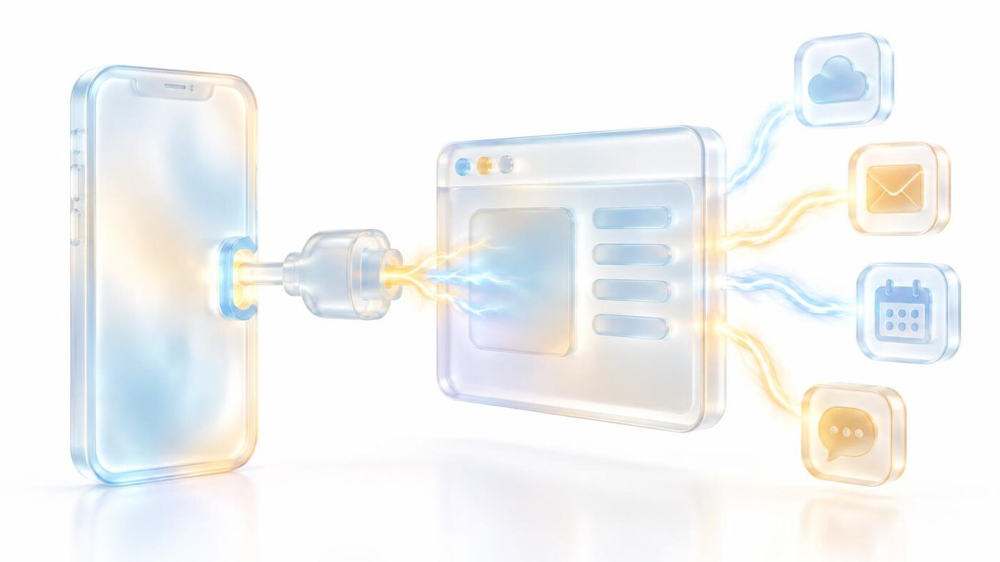
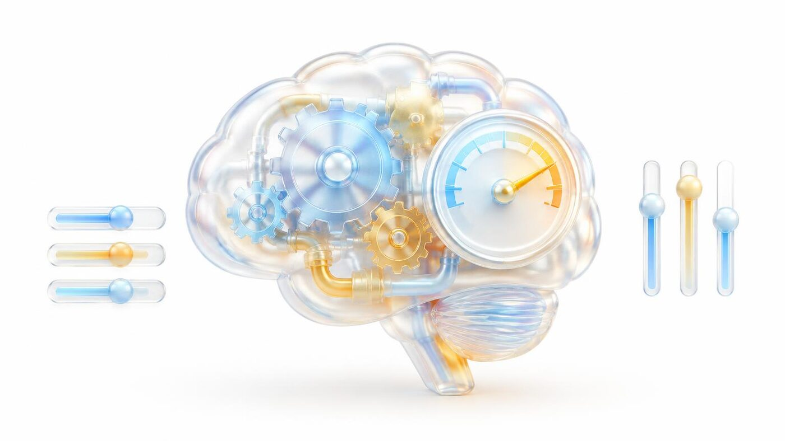

<Frame>
  
</Frame>

Your app can talk to the outside world, run on a schedule and use AI itself.

## Four ways to connect a service

1. **Built-in features** — database, sign-in, payments, email and storage come included.
2. **Your own API keys** — save them in **Setup & keys**; they're encrypted and never shown to your app's users.
3. **[MCP servers](/builder/mcp)** — give the agent live docs and tools from a vendor.
4. [**Connected apps (AI Builder Tool Router)**](#connected-apps-ai-builder-tool-router) — sign your app into a service instead of pasting keys, or let your app's users connect their own accounts (1,700+ apps).

When you ask for a category ("add payments"), Aura recommends options and confirms with you before choosing a vendor.

## Connected apps (AI Builder Tool Router)

Connected apps let your app use outside services — Google Drive, Gmail, Slack, HubSpot, Notion, Stripe and more than 1,700 others — through a sign-in instead of hand-built integrations. Open **Explore apps** or a project's **Connected apps** panel to browse them.

### Two ways an app connects

- **Business account** — you sign your app in once (for example, your company's Slack or Google account). Your app's server uses that one account for everyone. This replaces pasting an API key.
- **Per-user** — each of your app's users signs in with their own account, for example to pick files from _their_ Google Drive.

Some services support both. When you pick one, Aura asks which you need before it writes the build prompt.

### Benefits

- **No keys to find or paste** for most services — just sign in.
- **Faster, simpler builds** — the builder calls ready-made actions instead of writing and debugging each vendor's API, sign-in flow and token refresh.
- **Events without webhook plumbing** — where a service offers them, your app subscribes to events (a new email, a new row) and they arrive in your app automatically.
- **Sign-ins stay safe** — they're stored and refreshed by the connection service, never in your app's code.
- **One place to see it all** — the **Connected apps** panel shows which services your app uses, who signs in, and live prices.

### Limitations

- **Coverage varies.** Not every service offers every action or event. Before building, Aura checks whether the service covers what you asked for and tells you about gaps.
- **Some events still need a key.** Some providers refuse to send events (webhooks) to an app that connected through a sign-in. **Stripe** is the main example: Stripe doesn't allow webhooks over a signed-in (OAuth) connection. For those, Aura asks for your API key once, creates the webhook for you, saves its signing secret and doesn't keep the key.
- **It costs credits.** Connected-app accounts, actions and events are billed hourly to the app owner (or the project's payer) — live prices are in the **Connected apps** panel.
- **Separate from chat.** Apps you connect in Aura chat or Work Mode don't connect your built app, and the reverse.
- **Services can change.** If a provider changes its API or revokes a sign-in, your app may need to sign in again.

### What the setup check looks at

The **Setup** checklist reads your app's code and compares it with what's actually connected:

- **Sign-in** — whether your app's business account is signed in, both for the live app and for the preview so Aura can test it. It only asks you to sign in when the code uses a business account; per-user apps are signed in by your users.
- **API keys** — which keys the code still reads. A key drops off the list once a matching connected app is signed in _and_ the code no longer reads it. A connected app with missing actions or events never hides a key the code still needs.
- **Events** — whether every event your code subscribes to is actually switched on for the signed-in account, and whether your app's event address answers and rejects unsigned requests. Missing subscriptions are switched on automatically.
- **Events key** — for providers like Stripe that need an API key for events, whether that key and webhook are in place.

**Setup & keys → Webhooks** lists your app's live event subscriptions per environment. Aura doesn't see the contents of those events — they go straight from the service to your app.

## Webhooks

**Setup & keys → Webhooks** shows incoming events received, lets you send an end-to-end test, and sets up fallback and outgoing relays.

## Scheduled tasks

**Settings → Scheduled tasks** lists your app's recurring jobs — daily digests, syncs, reminders. Viewing is free; creating or changing one is a build.

## In-app AI

Your app can use AI features of its own (chatbots, summaries, image tools). **Settings → In-app AI** shows what it uses and costs.

## Code and GitHub

**Settings → Code & integrations** lets you connect GitHub, export or import a project, and clone it. Imports, clones and restores run in the background with progress shown. Transferred projects carry a summary of their build history so the agent keeps context.

## Visual editing

<Frame>
  
</Frame>

In **Preview**, use **Visual edit** to change text and styles by hand — free, written straight into the code — or **pick** an element to point the agent at exactly what to change.

## The build engine

Every build runs on Claude Opus at medium reasoning — tuned for quality per credit. Above the composer, a tips strip shows ways to save credits, and alerts appear in chat when your app needs a key or has a new finding.

## Common questions

<AccordionGroup>
  <Accordion title="Are my API keys safe?">Yes. They're encrypted and never shown to your app's users. Saving a key is free.</Accordion>
  <Accordion title="Can I take my code elsewhere?">Yes — export the project or connect GitHub from Settings → Code & integrations.</Accordion>
  <Accordion title="Does the builder use the AI Builder Tool Router?">Yes — whenever it sees an integration opportunity, it uses connected apps (1,700+). Usage is billed to you as the app owner, and it's separate from the connected apps in your Aura chat. See [Connected apps](#connected-apps-ai-builder-tool-router).</Accordion>
  <Accordion title="Why does Stripe still ask for an API key?">
    Stripe doesn't allow webhooks over a signed-in (OAuth) connection. Aura uses your key once to create the webhook, saves the signing secret and doesn't keep the key.
  </Accordion>
  <Accordion title="Is a manual visual edit the same as asking the agent to change it?">
    No. Manual **Visual edit** changes text and styles directly for free. Picking an element and asking the agent for a change gives it a targeted build request. Use the former for simple wording and styling; the latter when code or behavior needs to change.
  </Accordion>
  <Accordion title="Will connecting an app in Work Mode connect my built app too?">
    No. Chat connections and Builder setup are separate — the built app makes its own Tool Router connections when your app's users link their accounts. Configure the app itself using its built-in features, keys and MCP servers. See [Setup & keys](/builder/setup-keys).
  </Accordion>
</AccordionGroup>
